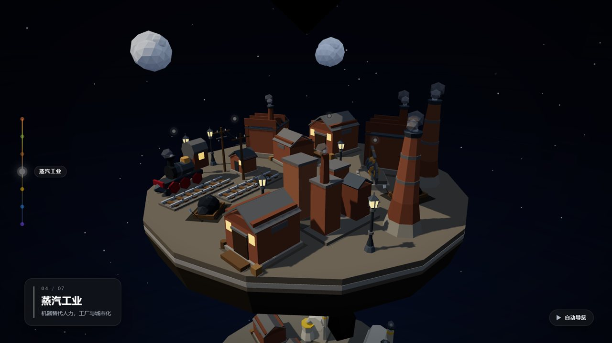
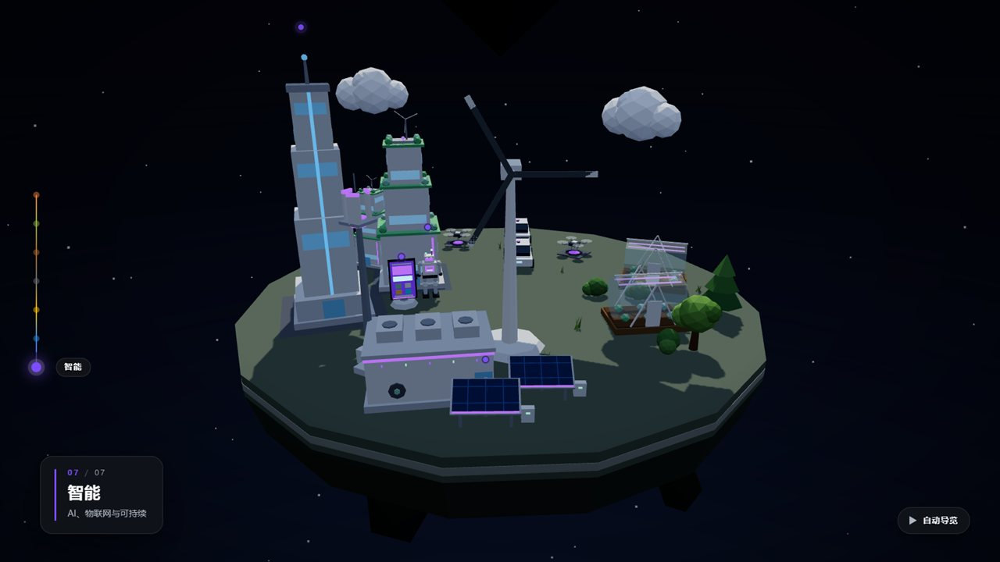
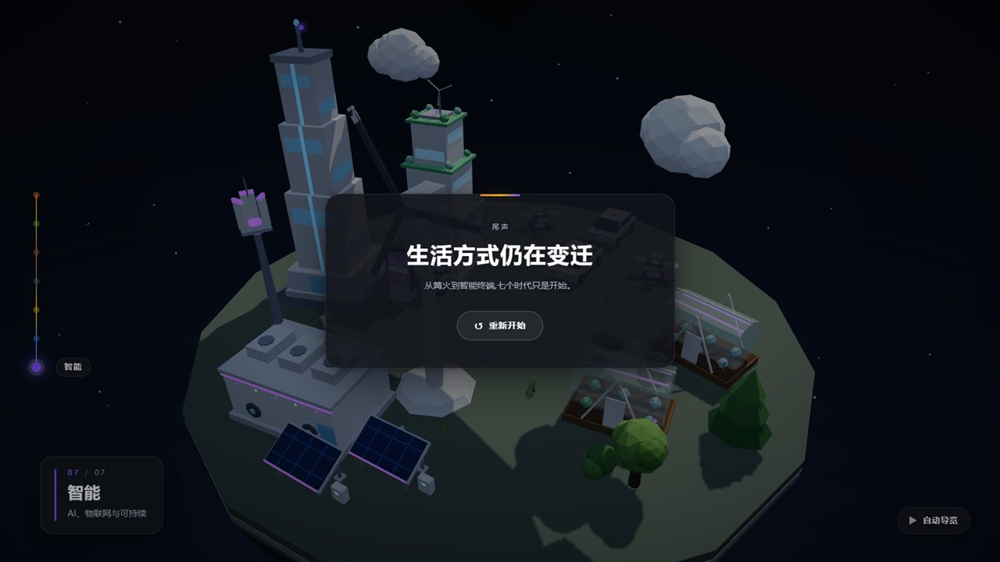

# 人类生活方式的变迁 · 3D 科普

滚动驱动的垂直「时间之柱」3D 科普页：7 个**浮动低模沙盘平台**（上=远古，下=现代）沿 Y 轴堆叠，相机沿螺旋路径下降；每层平台由**声明式场景数据**（`src/content/scenes/*.json`）程序化生成（Three.js 基础几何 + flat shading），知识点以可点击热点弹出数据卡（含数据来源链接）。

| 序章：时间之柱                             | 蒸汽工业（工厂 / 机车 / 电报）             |
| ------------------------------------------ | ------------------------------------------ |
|      |  |
| **智能时代（光伏 / 风机 / 机器人）**       | **尾声**                                   |
|  |        |

- 技术基线：[`docs/开发契约与架构.md`](docs/开发契约与架构.md)（所有并行开发者的唯一契约）
- 设计母文档：[`人类生活方式变迁-3D科普-设计文档.md`](人类生活方式变迁-3D科普-设计文档.md)
- 部署说明：[`docs/DEPLOY.md`](docs/DEPLOY.md)
- 验收数据：设计文档 §14（draw call 91 / 23–76，RTX 显卡实测 6.3 ms/帧，23 项单测 + 内容校验全绿）

---

## 7 个时代（内容概要）

| #   | 主题          | 色彩      | 副标题                               | 知识点（共 30 条）                                                     |
| --- | ------------- | --------- | ------------------------------------ | ---------------------------------------------------------------------- |
| 1   | 采集狩猎      | `#E8793A` | 居无定所，直接向自然取食             | 火的驯化、火烤熟食、语言与协作、人均寿命（4）                          |
| 2   | 农耕          | `#8FAE3B` | 定居、驯化动植物，第一次有了「剩余」 | 新月沃地农业、水稻驯化、剩余与储藏、轮子、楔形文字（5）                |
| 3   | 手工业 / 铁器 | `#A8662A` | 金属工具、城邦与贸易                 | 青铜与铁器、货币与市场、造纸与印刷（3）                                |
| 4   | 蒸汽工业      | `#6B6B6B` | 机器替代人力，工厂与城市崛起         | 瓦特蒸汽机、铁路与汽船、城市化与公共卫生、电报、人均寿命（5）          |
| 5   | 电气          | `#F2B705` | 电与内燃机重塑生产与生活             | 电灯与电话、汽车与飞机、家电与家务革命、人均寿命（4）                  |
| 6   | 信息          | `#2E86DE` | 计算机与互联网连接世界               | 晶体管与集成电路、互联网与万维网、电视与大众传媒、人均寿命（4）        |
| 7   | 智能          | `#7C4DFF` | AI、物联网与可持续                   | 智能手机与 5G、光伏成本、电动车与能源转型、人均寿命、大模型时间线（5） |

内容与数据全部来自 `src/content/eras.json`（50 条数据行，均带可核验来源链接）。四象限固定对应四个维度（能源与工具 / 食物 / 居住 / 交通），跨时代保持一致，便于对比。

## 技术栈

- **Vite 8** + **TypeScript 6**（strict）+ 原生 ESM
- **Three.js 0.186**：程序化低模几何、flat shading、无外部模型/贴图资产
- **GSAP**（依赖已就绪，用于需要补间的交互）
- **UI：原生 TS + DOM**（无框架），样式集中在 `src/ui/styles.css`
- **工具链**：ESLint 10 + Prettier 3 + Husky + lint-staged
- **校验/测试/截图**：自定义 Node 校验脚本、**Vitest 5**、**puppeteer-core 25**（复用本机 Chrome/Edge + SwiftShader）

## 目录结构

```text
F:\3Dmodel
├─ index.html                  # 页面骨架（#app / #ui-root / #scroll-spacer / #loading）
├─ vite.config.ts              # Vite 配置（GitHub Pages 需 base: './'，见 docs/DEPLOY.md）
├─ package.json
├─ src/
│  ├─ main.ts                  # 装配：渲染器/相机/滚动/UI；暴露 window.__DEV__ 调试接口
│  ├─ content/
│  │  ├─ eras.json             # 7 时代文案 + 30 知识点 + 数据来源（内容唯一来源）
│  │  ├─ index.ts              # 合并 eras + scenes，运行时内容自检
│  │  └─ scenes/<era-id>.json  # 每个时代的声明式场景（ground + props + anchorId）
│  ├─ core/                    # ScrollController / TimelineMap / CameraRig / HotspotProjector / SceneManager
│  ├─ scene/
│  │  ├─ SceneRenderer.ts      # 场景解释器：按 JSON 程序化生成平台与道具
│  │  ├─ Environment.ts        # 灯光 / 星空 / 雾 / 时代氛围
│  │  ├─ primitives.ts         # 道具图元 API（BuildCtx）
│  │  ├─ layout.ts             # 世界尺度常量（平台半径、层间距等）
│  │  └─ props/                # 道具注册表：era1-hunter.ts（共享池）、era2..era7-*.ts
│  ├─ types/                   # content / scene schema 类型
│  └─ ui/                      # IntroCard / InfoBar / TimelineSlider / HotspotLayer / DataModal / EndCard / AutoTour
├─ scripts/
│  ├─ validate-content.mjs     # 内容/场景/锚点校验（npm run validate）
│  └─ screenshot.mjs           # 滚动停留点截图（npm run shots）
├─ tests/
│  ├─ content.test.ts          # 7 时代 / 30 知识点 / 锚点覆盖（纯 Node 读 JSON）
│  └─ timeline.test.ts         # TimelineMap 纯函数：progress→关键帧位/相机位姿插值
├─ docs/
│  ├─ 开发契约与架构.md         # 开发契约（§2 写作用域、§4 schema、§6 锚点、§9 验收）
│  └─ DEPLOY.md                # GitHub Pages / Netlify / Vercel 部署
├─ .github/workflows/deploy.yml# push main 自动构建并发布 GitHub Pages
└─ artifacts/shots/            # npm run shots 生成的截图（本地产物，不入库）
```

## 快速开始

```powershell
npm install        # 安装依赖（husky 会自动装 git hooks）
npm run dev        # http://localhost:5173
npm run build      # tsc + vite build → dist/
npm run preview    # 预览 dist，http://localhost:4173
```

> 本机需安装 Google Chrome 或 Microsoft Edge 才能跑 `npm run shots`（puppeteer-core 复用系统浏览器，不下载 Chromium）。

## npm 脚本

| 脚本                | 说明                                                            |
| ------------------- | --------------------------------------------------------------- |
| `npm run dev`       | 开发服务器（Vite，默认 5173 端口）                              |
| `npm run build`     | 类型检查 + 生产构建到 `dist/`                                   |
| `npm run preview`   | 本地预览构建产物（默认 4173）                                   |
| `npm run typecheck` | `tsc --noEmit` 纯类型检查                                       |
| `npm run lint`      | ESLint 全仓检查                                                 |
| `npm run format`    | Prettier 格式化全仓                                             |
| `npm run validate`  | **内容/场景/锚点校验**（见下），有 error 时非零退出             |
| `npm run test`      | **Vitest** 单元测试（内容 schema + TimelineMap 纯函数）         |
| `npm run shots`     | **滚动停留点截图**到 `artifacts/shots/`（需先启动 preview/dev） |

### 内容校验：`npm run validate`

校验范围（对应契约 §4 / §6 / §9）：

1. `src/content/eras.json`：`schemaVersion`、7 个时代、`id`/`index` 唯一且连续、每个知识点的 `id` / `anchor.mesh` / `title` / `body` / `data`（`label` / `value` / `source` 含 URL）。
2. `src/content/scenes/*.json`：`eraId` 与文件名 / `eras.json` 对应、`ground.top`/`side`、`props` 数量 10–40、`prop.type` 在道具注册表中、`pos` 为 3 个数字且 `|x|,|z| ≤ 12`（越界警告）、`scale > 0`、`anchorId` 指向本时代知识点。
3. 契约 §6 的**必需锚点**必须被某个 prop 的 `anchorId` 覆盖。
4. 同一时代内同一道具类型出现 > 6 次、四象限有空白 → 警告。

退出码：`0` = 通过（可能有 warning）；`1` = 有 error。开发中途缺失文件/场景时报 error 属正常，补齐后即通过。

### 截图验收：`npm run shots`

```powershell
npm run build
npm run preview                     # 另开终端
npm run shots                       # → artifacts/shots/{00-intro,era1..era7,08-end}.png
npm run shots -- --url http://127.0.0.1:5173/ --out artifacts/shots-dev
npm run shots -- --wait-ready-timeout 120000   # 场景多、首帧构建慢时调大等待
```

- 通过 `window.__DEV__.setProgress(p)` 驱动滚动进度；等待 `window.__DEV__.ready === true`（默认最长 90s，可用 `--wait-ready-timeout` 调整）。
- 截图点：序章 `p=0.02`；时代 i（0..6）用 `__DEV__.progressForEra(i)` 解析出的**驻留位**（不再写死公式，避免落在过渡中段）；结语 `p=0.99`。
- 每张截图前 `setProgress(p)` → 等 900ms 稳定 → 读取 `__DEV__.state()`（progress/eraIndex/f）与 `__DEV__.info()`（calls/triangles/geometries）→ 截图并打印，便于核对每帧落位与性能。
- 汇总性能采样并对照目标 `calls < 300`（超出只告警，不阻塞截图）。
- 使用本机 Chrome/Edge + SwiftShader 软件 WebGL（`--use-angle=swiftshader --enable-unsafe-swiftshader`）。
- 出现 WebGL 失败 / 控制台 error / 页面异常时打印原因并非零退出；`favicon.ico 404` 会降级为 warning。

## 内容维护指南

> 原则：**内容即数据，代码是通用解释器**。改文案/加知识点/加道具基本只改 JSON，不改渲染代码。

### 改文案（标题、正文、数据）

编辑 `src/content/eras.json` 对应时代：

- `title` / `subtitle` / `themeColor`：时代标题与主题色（`#RRGGBB`）。
- `knowledgePoints[].title` / `body`：热点数据卡文案。
- `knowledgePoints[].data[]`：`label`（指标名）、`value`（数值/年份）、`source`（来源，**必须含 URL**，供数据卡"来源"链接）。

改完跑 `npm run validate` 与 `npm run test` 确认。

### 加一个知识点（热点）

1. `eras.json` 的该时代 `knowledgePoints` 追加一条：
   `{ "id": "kp-xxx", "anchor": { "mesh": "<anchorId>" }, "title": "...", "body": "...", "data": [ ... ] }`
   - `anchor.mesh` 必须是该时代 §6 锚点集合中的某个 id（新锚点需同步契约表）。
2. 在 `src/content/scenes/<era-id>.json` 的某个 prop 上挂 `"anchorId": "<anchorId>"`（同一锚点只需挂一次）。
3. 若这是**必需锚点**（契约 §6），三处同步：`docs/开发契约与架构.md` §6 表、`scripts/validate-content.mjs` 的 `REQUIRED_ANCHORS`、`tests/content.test.ts` 的 `REQUIRED_ANCHORS`。
4. `npm run validate` + `npm run test`，再 `npm run shots` 看热点位置。

### 加/改场景道具

- 在对应时代 `src/content/scenes/<era-id>.json` 的 `props` 里加：
  `{ "type": "<道具类型>", "pos": [x, y, z], "rotY": 0.35, "scale": 1.1, "anchorId": "可选", "params": { ... } }`
  - `pos` 建议 `|x|,|z| ≤ 10.5`（>12 校验警告）；`y=0` 贴地，悬浮物（云/飞机/手机）可给正 `y`。
  - 四象限与维度对应固定：能源与工具=西北、食物=西南、居住=东北、交通=东南，中心 ±3 留给通讯/标志物。
- 道具类型必须已在 `src/scene/props/era*.ts` 的 `builders` 中定义（归属见契约 §7；共享池在 `era1-hunter.ts`）。新建道具 = 在该文件 `builders` 里加 `<type>: (ctx, params) => { ... }` 并 return `{ anchorY }`。
- 场景 props 建议 18–34 个（硬性 10–40），同类型 ≤ 6 次。

### 加一个时代

当前产品硬编码 **7 个时代**（`ERA_COUNT = 7`）。若确需增加：

1. `src/content/eras.json` 追加时代，`index` 连续（0..N-1），更新主题色/文案/知识点。
2. 新增 `src/content/scenes/<era-id>.json`（`eraId` = 文件名 = eras.json id）。
3. 同步常量：`scripts/validate-content.mjs`（`EXPECTED_ERAS`、`EXPECTED_KNOWLEDGE_POINTS`、`REQUIRED_ANCHORS`）、`tests/content.test.ts`、`tests/timeline.test.ts`（`ERA_COUNT`）、`src/main.ts` 与 `src/core/TimelineMap` 的时代数。
4. 契约 §6 表、§7 道具归属表同步更新。
5. `npm run validate && npm run test && npm run build && npm run shots`。

> 修改 `src/` 任意文件前，先确认写作用域（契约 §2）；`scripts/`、`tests/`、`package.json`、`README.md`、`docs/DEPLOY.md`、`.github/` 由工具链（T）维护。

## 部署

见 [`docs/DEPLOY.md`](docs/DEPLOY.md)：GitHub Pages（默认，`.github/workflows/deploy.yml` 自动构建发布）、Netlify / Vercel 静态托管备选。

> **注意**：GitHub Pages 项目页需要相对资源路径，`vite.config.ts` 必须设置 `base: './'`，否则部署后 `assets/*` 会 404。
